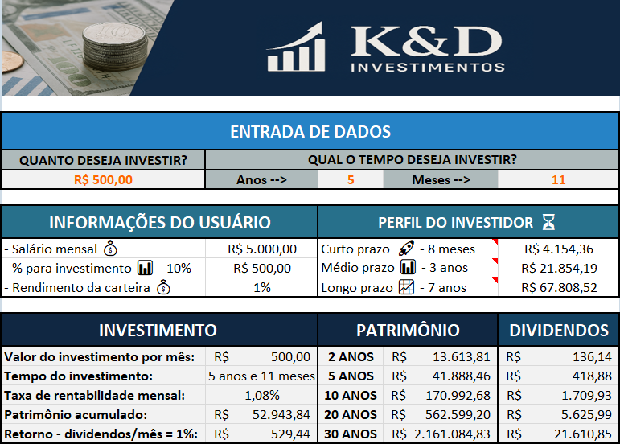

### <i> Criando uma Ferramenta de Controle de Investimentos com Excel. </i>

 

 

> #### 🎯 OBJETIVO DO PROJETO

- Auxiliar possíveis investidores a simular transportes em Fundos Imobiliários (FIIs), utilizando uma planilha Excel de forma automatizada.
- A ferramenta permite simular diferentes cenários de investimento, considerando gastos mensais, tempo de aplicação e taxas de rendimento.

---

> #### 📝 ETAPAS DO PROJETO

- 📚 Etapa 1: Fundamentação Teórica.
- 📊 Etapa 2: Planejamento da Ferramenta.
- 📈 Etapa 3: Construção da planilha em Excel.
- 🎯 Etapa 4: Validação e Finalização.

---

> #### ✅ PONTOS ACRESCENTADOS NO PROJETO

- <b>Perfil do investidor </b> - Simulações rápidas e objetivas de curto, médio e longo prazos.

- <b>Tempo do investimento </b> – Como o investidor pode querer investir em anos + meses, coloquei uma fórmula que calcula automaticamente esse tempo de investimento, utilizei outra fórmula para unir as duas e obter o resultado como ex. 5 anos e 3 meses.

- <b>Gráficos simples </b> – Como o projeto é bem básico, não me ative a estruturar gráficos como por exemplo linha do tempo e nem segmentação de dados.

---

> #### 📝 FUNCIONALIDADES DESENVOLVIDAS NO DESAFIO

1. Criação do Banner 🎨
   Descrição: Criei o banner junto do Copilot e solicitei melhoria no ChatGPT.
2. Tabelas de Apoio 📊
   Descrição: Desenvolvimento de tabelas auxiliares que organizam e sistematizam os dados utilizados nos cálculos da planilha.
   Para utilizar as duas guias da tabela basta acessar pelos botões colocados no cabeçalho de cada planilha.
3. Variáveis ​​Globais ⚙️
   Descrição: Definição de parâmetros essenciais como variações globais do tipo 'Salário, Rendimento da Carteira, Investimento Mensal e Taxa de Rendimento Mensal'.
4. Gerenciador de Nomes (Gerenciador de Nomes) 🏷️
   Descrição: Utilização do recurso “Name Manager” do Excel para tratar nomes a intervalos e células-chave, mas, não utilizei em nenhuma célula
5. Uniformidade Visual 🎯
   Descrição: Layout cuidadosamente desenvolvido para manter uma aparência consistente e profissional, utilizei uma paleta de cores de tom azul esverdeado para padronizar o layout.
6. Gráficos simples 📊 Barra e rosca com os percentuais de investimento.
   Descrição: Inserção de um gráfico de rosca que ilustra a distribuição percentual sugerida do portfólio.

---

> #### 🛠️ FERRAMENTAS UTILIZADAS

- Microsoft Excel 365
- VSCode
- Git
- GitHub

---

> #### 🧩 TIPO DE DESAFIO

- Excel básico.

---

> #### 🏆 Créditos

  - ver mais em <a href="https://github.com/angelicakadja">AK</a>.

