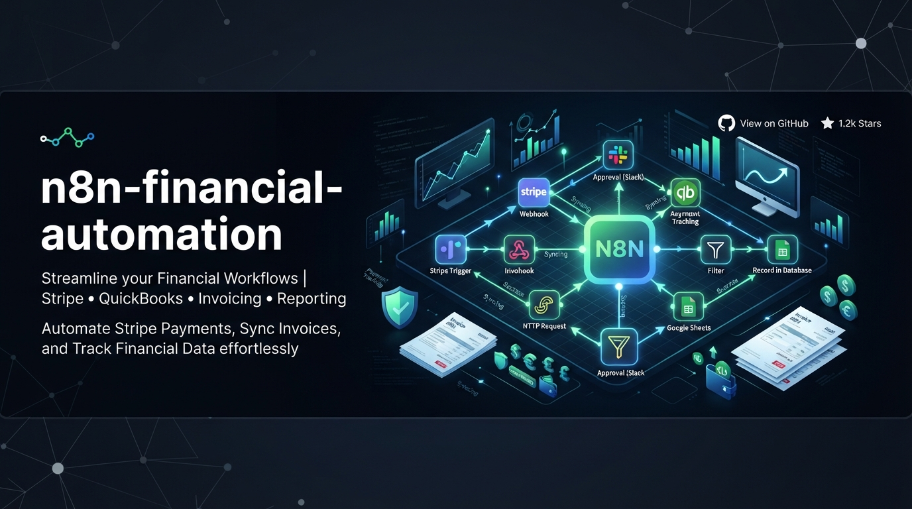
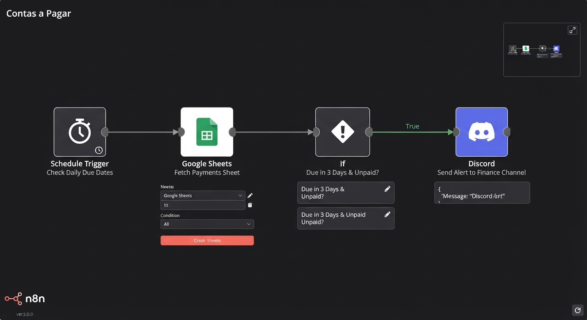
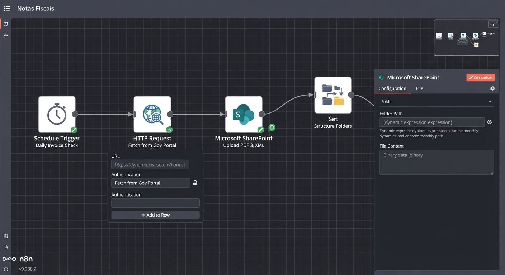

## Projeto 01 - Planejando Automações com N8N!

 

---

> ### 🎯 OBJETIVO DO PROJETO

O objetivo principal deste projeto é aplicar conceitos avançados de engenharia de prompts e planejamento de fluxos com N8N para desenvolver automações inteligentes voltadas ao setor financeiro.  
A solução foca em otimizar e centralizar dois processos críticos de negócios:
* **Fluxo de Contas a Pagar:** Automatização do controle, validação e agendamento de pagamentos para reduzir erros manuais e retrabalho.
* **Fluxo de Notas Fiscais:** Gestão integrada e rastreio automatizado de emissão e recebimento de notas fiscais, garantindo maior agilidade e conformidade nos registros.

---

> ### 📝 ETAPAS DO PROJETO

#### 💸 Planejamento da Automação: Contas a Pagar

**Passo 1: Definição da Automação**
* **Processo:** Criar uma automação no n8n para gerenciar, validar e agendar o fluxo de Contas a Pagar.
* **Público ou responsável:** Equipe Financeira.
* **Resultado esperado:** Centralizar o recebimento de faturas, validar os dados de pagamento e programar as liberações sem intervenção manual excessiva, evitando multas e atrasos.

**Passo 2: Contexto e Regras**
* **Ferramentas envolvidas:** Google Sheets, n8n, API de Pagamentos / Gateway e E-mail / Slack.
* **Fluxo desejado:**
  1. Monitorar a chegada de novas faturas ou registros de boletos em uma planilha/sistema.
  2. Extrair e validar os dados principais (valor, vencimento, fornecedor).
  3. Enviar uma notificação para aprovação gerencial (via Slack ou E-mail).
  4. Agendar ou registrar o pagamento após a confirmação.
* **Regras importantes:** Rejeitar automaticamente faturas com valores divergentes ou dados corrompidos, notificando o setor responsável para checagem manual.

**Passo 3: Prompt Final Estruturado**
> Atue como um especialista em N8N.
> Crie uma automação para gerenciar e validar o processo de Contas a Pagar.
> 
> Público: Equipe financeira.
> Ferramentas envolvidas: Google Sheets, n8n, serviços de mensageria (Slack/E-mail).
> Fluxo: Receber faturas, extrair/validar dados, solicitar aprovação e agendar o pagamento.
> Regras: Ignorar registros com dados incompletos e alertar sobre divergências.
> Explique quais nós do N8N devem ser utilizados e a lógica de funcionamento do workflow.

---

#### 🧾 Planejamento da Automação: Notas Fiscais

**Passo 1: Definição da Automação**
* **Processo:** Criar uma automação no n8n para o controle, emissão, salvamento e rastreio de Notas Fiscais.
* **Público ou responsável:** Setor Fiscal e Contábil.
* **Resultado esperado:** Automatizar o ciclo de vida das notas fiscais, garantindo o armazenamento seguro dos arquivos e o envio imediato aos clientes/fornecedores.

**Passo 2: Contexto e Regras**
* **Ferramentas envolvidas:** Google Drive, Google Sheets, n8n, sistema de emissão de NF e E-mail.
* **Fluxo desejado:**
  1. Acionar o fluxo a partir de um novo pedido aprovado ou de uma solicitação de emissão.
  2. Gerar/capturar o arquivo da Nota Fiscal correspondente.
  3. Salvar o documento estruturado no Google Drive e registrar as informações em planilha.
  4. Enviar a nota fiscal por e-mail para o destinatário final.
* **Regras importantes:** Garantir que o envio de e-mail só ocorra se o arquivo PDF da nota estiver devidamente gerado e validado.

**Passo 3: Prompt Final Estruturado**
> Atue como um especialista em N8N.
> Crie uma automação para gerenciar o fluxo de emissão, registro e envio de Notas Fiscais.
> 
> Público: Setor fiscal e contábil.
> Ferramentas envolvidas: Google Drive, Google Sheets, n8n e Gmail.
> Fluxo: Capturar solicitação, gerar/organizar documento da NF, salvar em nuvem e enviar por e-mail.
> Regras: Validar a presença do arquivo PDF antes de disparar o e-mail de confirmação.
> Explique quais nós do N8N devem ser utilizados e a lógica de funcionamento do workflow.

---

> ### 🤖 Automações Financeiras com N8N

Este repositório contém a documentação e a lógica de dois fluxos de automação desenvolvidos para otimizar processos financeiros utilizando o N8N.

> #### ✅ PONTOS ACRESCENTADOS NO PROJETO - PROMPTS FINAIS PARA CADA FLUXO

*FLUXO CONTAS A PAGAR*:

#### 📅 1. Alertas de Contas a Pagar

**🎯 Objetivo**
Automatizar o envio de alertas de vencimento de boletos e faturas para o setor financeiro com 3 dias de antecedência, evitando atrasos e multas.

* **Público / Responsável:** Equipe financeira / Gestor financeiro.
* **Ferramentas envolvidas:** Google Sheets e Discord (ou WhatsApp).

**🔄 Fluxo Desejado**
1. Consultar diariamente a base de dados de contas a pagar na planilha.
2. Identificar quais faturas e boletos vencem exatamente daqui a 3 dias.
3. Enviar uma mensagem de alerta detalhada para o canal do setor financeiro.

**⚠️ Regras Importantes**
* Ignorar boletos que já constem com o status de "Pago" na planilha.
* Não enviar alertas repetidos para a mesma fatura.

**🛠️ Nós Utilizados no N8N e Lógica**
* **Schedule Trigger:** Aciona o workflow automaticamente todos os dias em um horário comercial definido.
* **Google Sheets (Get Many Rows):** Busca todas as linhas da planilha de controle financeiro.
* **If (Node de Condição):** Filtra os registros aplicando duas regras: se a data de vencimento é exatamente daqui a 3 dias E se o status é diferente de "Pago".
* **Discord / Webhook:** Formata a mensagem com os dados da fatura e envia o alerta para o canal correspondente.

**Print do Fluxo no N8N:**

*FLUXO NOTAS FISCAIS*:
#### 🧾 2. Download Automático de Notas Fiscais

**🎯 Objetivo**
Baixar automaticamente notas fiscais emitidas no portal da prefeitura e salvá-las no SharePoint na pasta do mês correspondente, agilizando o trabalho da contabilidade.

* **Público / Responsável:** Equipe fiscal / Contabilidade.
* **Ferramentas envolvidas:** Portal da Prefeitura, Microsoft SharePoint e E-mail.

**🔄 Fluxo Desejado**
1. Acessar diariamente o portal da prefeitura para verificar novas notas fiscais emitidas.
2. Baixar automaticamente os arquivos PDF e XML das notas encontradas.
3. Organizar e salvar os arquivos no SharePoint dentro da pasta específica do mês correspondente.

**⚠️ Regras Importantes**
* Se a pasta do mês atual ainda não existir no SharePoint, o fluxo deve criá-la automaticamente antes de salvar os arquivos.

**🛠️ Nós Utilizados no N8N e Lógica**
* **Schedule Trigger:** Executa a rotina de verificação periodicamente.
* **HTTP Request / Web Scraping:** Conecta-se ao portal da prefeitura para buscar e baixar os arquivos das notas fiscais.
* **Microsoft SharePoint (Create Folder / Upload File):** Verifica a existência da pasta mensal (criando-a caso não exista) e realiza o upload dos arquivos PDF/XML.
* **Email (Send):** Opcional, para notificar a equipe fiscal de que novos arquivos foram salvos com sucesso.

**Print do Fluxo no N8N:**

---

> #### 🛠️ FERRAMENTAS UTILIZADAS

- 🌐 **[n8n]**
- 🚀 **Google Antigravity**
- 💻 **VSCode**
- 🐙 **Git**
- ⚡ **GitHub**

---

> #### 🧩 TIPO DE DESAFIO

- Básico à Intermediário.

---

 
Feito com , até mais!

👧🏽 - ver mais em <a href="https://github.com/angelicakadja">AK</a>.

